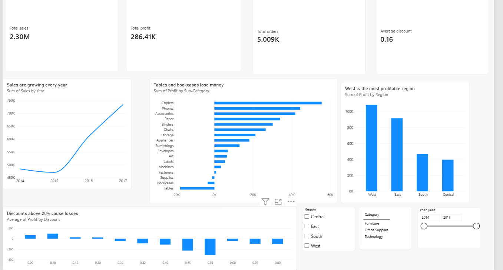

# Superstore Sales & Profit Analysis

In this project, I analyzed 4 years of sales data from a US store to find where it makes money, where it loses money, and what it can do better.

**Tools I used:** Excel (Pivot Tables) and Power BI

## The Problem

The store sells a lot, but its profit is low. I wanted to find out why.

## The Data

- Sample Superstore dataset from [Kaggle](https://www.kaggle.com/datasets/vivek468/superstore-dataset-final)
- 9,994 rows (about 5,000 orders) from 2014 to 2017
- Includes sales, profit, discount, product, region and customer details

## What I Did

1. **Explored the data** to understand each column
2. **Cleaned the data** in Excel: removed 1 duplicate row, checked for empty cells and wrong values, and added new columns (Order Year, Order Month, Shipping Days, Profit Margin)
3. **Analyzed the data** with pivot tables to answer 8 business questions
4. **Built a Power BI dashboard** with KPI cards, charts and filters

## What I Found

- Sales grew about **52%** and profit grew about **89%** from 2014 to 2017
- Orders with **more than 20% discount lose money**. These orders lost about **$135K** in total
- **Tables and Bookcases** lose money
- **Texas** loses the most money, and it also gives very high discounts
- **West** is the most profitable region
- **September to December** bring 43% of all sales
- The **top 10 customers** bring 17.5% of all profit

## My Recommendations

1. Keep discounts at **20% or less**
2. Reduce discounts or raise prices for **Tables and Bookcases**
3. Review discount rules in **Texas, Ohio, Pennsylvania and Illinois**
4. Stock up before the **busy season** and reward **top customers**

## What I Learned

- How to clean data and why it matters
- How to use pivot tables to answer business questions
- How to build a dashboard in Power BI
- How to turn findings into business advice

## Project Files

- `data/` – the original dataset
- `analysis/` – the cleaned Excel file with 8 pivot tables
- `dashboard/` – the Power BI dashboard
- `screenshots/` – a picture of the dashboard

## Author

**Meghana Thigulla**
